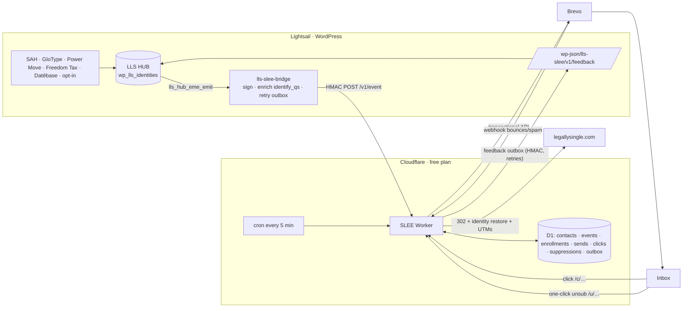

# Architecture

## Design decisions
- **HUB = source of truth for identity; SLEE = source of truth for journeys.** SLEE keeps an additive mirror of HUB attributes, just enough to personalize.
- **Change detection, not event labels.** `inferSignals()` compares before and after. A generic HUB write that adds `SAH_SCORE` still starts the SAH journey, so new plugins integrate without SLEE changes.
- **Journeys as code** (`src/engine/sequences.ts`) and **copy as code** (`src/templates/index.ts`). Changes go through Git review → auto-deploy.
- **A global frequency cap** (`MIN_HOURS_BETWEEN_EMAILS`) applies across every journey, so nobody gets two emails in one day.
- **Brevo is a dumb pipe.** Deliverability, unsubscribes and suppressions are owned by SLEE and mirrored back to Brevo (blacklist) so newsletters respect them too.
- **Resilient both ways.** WP outbox retries if the Worker is unreachable; the D1 outbox retries if Lightsail is down (useful given past outages).
- **Free-plan native.** No Queues, KV or Durable Objects. Cron + D1 do the scheduling. Bulk writes use `json_each()` to stay under 50 queries per invocation.

## Journeys (v1)
| Sequence | Trigger | Steps |
|---|---|---|
| `sah_nurture` | new SAH score | +1d meaning (tier copy) · +3d Freedom Tax™ · +4d GloType or Power Move · +6d full platform |
| `power_move_activation` | Power Move opt-in | +2h activate · +3d SAH quiz or next move |
| `glotype_followup` | GloType result | +1d element + next door |
| `freedom_tax_nurture` | calculator result | +1d · +4d UnWedded Wallet™ |
| `welcome` | plain opt-in (no SAH yet) | now · +3d SAH quiz; exits when they take SAH |
| `reengage` | legacy import | now · +7d · +7d · +7d sunset; exits on any click or quiz |

**SAH tiers** come from the quiz's own status text, with a score fallback:
- TRUE ("Congratulations…")
- MOSTLY ("more than a few ways")
- SOME ("a few ways")
- NOT

**CIA tier** (`derive.ts → ciaTier`) is a simple placeholder. Replace it with the full CIA spec from the EME specification.

## Known assumptions to verify against HUB code
1. HUB's `lls_hub_eme_emit()` sends JSON containing `email` (any casing) using `wp_remote_post` with `blocking => true`. If it is non-blocking, the bridge still signs requests, but failures can't be detected for retry. In that case, call `lls_slee_emit()` instead.
2. `lls_hub_generate_identify_url()` argument order. The bridge maps arguments by parameter name; override with the `lls_slee_identify_qs` filter if needed.
3. HUB ingest route for feedback (`/lls-hub/v1/ingest`). Override the mapping with the `lls_slee_feedback_to_hub` filter if HUB expects a different shape.
